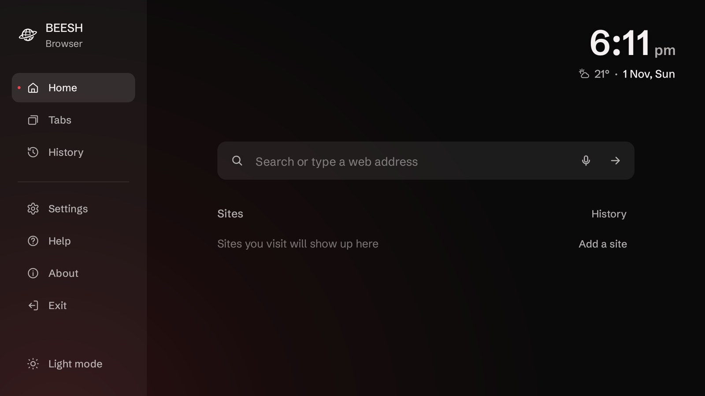
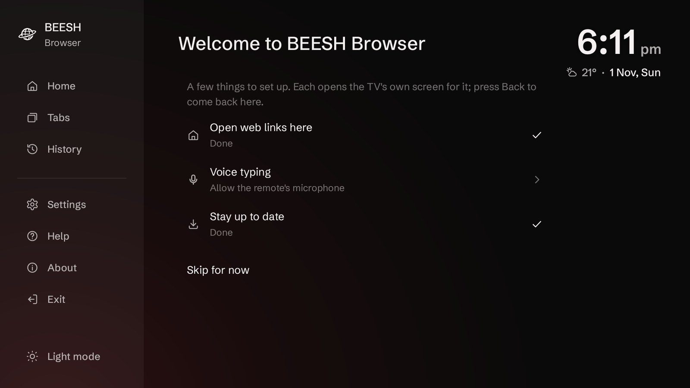
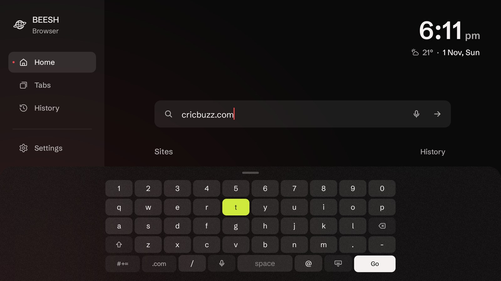
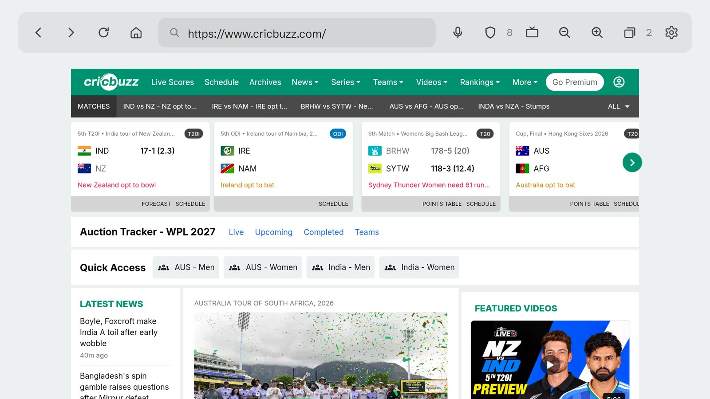
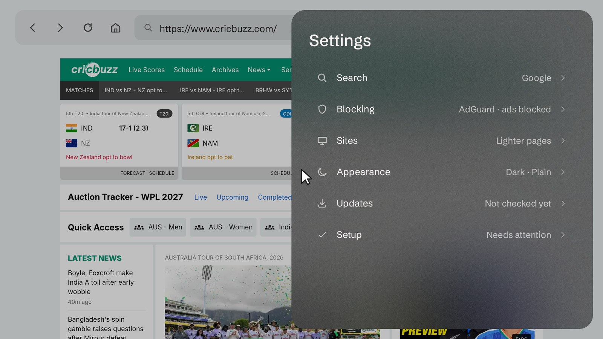

# BEESH Browser

A web browser made for the TV remote. A pointer moves over everything with the arrow keys, like a
mouse: OK clicks, pushing past an edge scrolls. The bar above the page has back, forward, reload, home,
the address, voice search, ad blocking, desktop site and zoom.

Built on the TV's own Android System WebView (Chromium), so pages render like they do in Chrome. It
pairs with [BEESH Launcher](https://github.com/bishwofic/BeeshTVLauncher) but works on its own.



| First run | Keyboard |
|---|---|
|  |  |

| A website | Settings, over the website |
|---|---|
|  |  |

## Features

- **A home page** with the weather and time, a big search box and your shortcuts (hold OK on one
  to remove it). It's plain dark to start with; **Settings → Appearance → Background → Frosted TV
  Home** puts your TV's Home screen behind it instead (from BEESH Launcher), heavily blurred with a
  fine grain so text stays easy to read.
- **A pointer for the D-pad.** It starts slow for precise aim and speeds up while you hold a
  direction. OK clicks (hold for a long press), hovering opens menus, and pushing the pointer against
  any edge scrolls whatever is under it, inner panes included. Page Up / Down and Channel Up / Down
  scroll a screen at a time.
- **One box for everything.** Type a web address to open it, or anything else to search Google,
  DuckDuckGo, Bing or Brave. The microphone button searches by voice.
- **DNS protection**, AdGuard by default: every site is checked with the DNS service you pick (AdGuard,
  AdGuard Family, Cloudflare, Cloudflare Family, OpenDNS, OpenDNS FamilyShield, Quad9, or off) over
  encrypted DNS, and what it blocks doesn't load. Android doesn't let an app change the DNS server
  the page engine uses, so the TV's own DNS still does the lookups (`install.sh` in BEESH Launcher
  sets that to AdGuard too).
- **Ad and tracker blocking**, on by default. It starts with a built-in list and switches to
  [Steven Black's hosts list](https://github.com/StevenBlack/hosts) (about 80,000 ad and malware hosts),
  refreshed weekly. The bar shows how many requests were blocked on the page, and the shield turns
  blocking off for one site that won't work with it.
- **No "turn off your ad blocker" walls**, on every site. Sites test for an ad blocker by loading a
  well-known ad script; that test passes here (with nothing loaded, so still no ads), even when it's
  the TV's own DNS doing the blocking. The usual detector scripts are told there's no ad blocker, and
  a wall that shows anyway is taken off the page, with its dimmed backdrop, so you can scroll again.
- **Video players that just play.** Players inside frames often stop with "sandboxed iframe" or
  "disable your popup blocker" messages. Frames are never sandboxed, pop-ups get a harmless stand-in
  instead of a window, and the browser doesn't tell sites it's an app (no X-Requested-With header).
- **Pop-ups blocked**: a link you click opens in the tab, anything a page tries to open on its own
  doesn't.
- **Desktop site** per site, for the odd site that still needs a Windows browser; every site already
  opens in its full desktop layout, fitted to the screen. Fitted to whichever screen it's on: a TV
  with room for more lays pages out at its own width, at 100%, instead of enlarging a smaller one.
- **Zoom** per site, from 50% to 200%, remembered for next time.
- **Full-screen video** with Back to leave it. When a video with sound starts, a small **Full screen**
  button appears at the bottom for a few seconds. The screen stays on while a video plays, so the TV's
  screensaver and display timer wait, and with **Lighter pages** on the page behind it drops its blur
  and looping animations until the video stops.
- **Downloads**, under History: files from websites are saved by the TV's own download service to its
  Downloads folder, with progress, and a button to open them when they're done. Apps (APKs) open in
  the TV's installer; pictures, videos and music with no app to open them open in a tab.
- **Opens web links from other apps**: choose BEESH Browser and Always when the TV asks.
- **Updates itself** from this repo's GitHub releases, like BEESH Launcher.
- Small: about 500 KB, since the page engine is the TV's own.

## Using it

| Remote | |
|---|---|
| Arrows | Move the pointer (hold to go faster); push past an edge to scroll |
| OK | Click; hold for a long press |
| Menu | Type in the address |
| Back | Previous page; from the first page, the home page; there, twice to close |
| Page Up / Down, Channel Up / Down | Scroll a screen at a time |

In the bar, from the left: back, forward, reload, home, the address, voice search, ad blocking on
this site (with the number blocked), desktop site, zoom out, zoom in, and settings. The site-only
buttons are hidden on the home page. Menu puts the D-pad in the bar for typing; Down or Back leaves it.

**Settings** has the search engine, the home page background, DNS protection, pop-up blocking, ad
blocking and its list, desktop sites by default, clearing cookies and history, and updates.

## Install

You need a computer with `adb` on the same Wi-Fi as the TV (`brew install android-platform-tools` on
a Mac). Works on Android TV and Google TV running Android 9 or newer.

1. On the TV, open **Settings → System → About** and press OK on **Android TV OS build** seven times.
   Go back to **Settings → System → Developer options** and turn on **USB debugging**.
2. Find the TV's IP address in **Settings → Network & Internet** (select your Wi-Fi network).
3. Download this repo (or just `dist/BeeshTV-Browser-2.0.apk` and `install.sh`) and run:

   ```bash
   ./install.sh 192.168.1.20
   ```

`install.sh` installs the APK, lets it install its own updates, and opens it. To remove it:
`./install.sh 192.168.1.20 --undo`.

Without a computer, download `BeeshTV-Browser-2.0.apk` from the
[latest release](https://github.com/bishwofic/BeeshTVBrowser/releases/latest), copy it to the TV (a USB
stick, LocalSend, or a downloader app) and open it.

## Updates

New versions are published as [GitHub releases](https://github.com/bishwofic/BeeshTVBrowser/releases).
The browser looks for one every six hours, downloads it in the background, and shows **Update** in
the bar when it's ready. The TV asks you to confirm before it installs.

To publish one: bump `android:versionCode` and `android:versionName` in `browser/AndroidManifest.xml`,
then run `./release.sh`, which builds the APK and publishes it as release `v<versionName>` with the
GitHub CLI. Keep `browser/debug.keystore`: an update signed with a different key won't install over
the old one.

## Build it yourself

No Gradle, just the SDK command-line tools:

```bash
brew install openjdk@17 android-commandlinetools
yes | JAVA_HOME=/opt/homebrew/opt/openjdk@17 sdkmanager \
  --sdk_root=/opt/homebrew/share/android-commandlinetools "platforms;android-34" "build-tools;34.0.0"

browser/build.sh                 # builds dist/BeeshTV-Browser-<version>.apk
browser/build.sh 192.168.1.20    # builds and installs
```

The APK is signed with `browser/debug.keystore`, created on the first build (it isn't in the repo).

## Credits

- Page engine: the TV's Android System WebView (Chromium), with
  [AndroidX WebKit](https://developer.android.com/jetpack/androidx/releases/webkit) (Apache 2.0) in `browser/libs/`.
- Site icons on the home page: Google's favicon service.
- Ad and tracker list: [StevenBlack/hosts](https://github.com/StevenBlack/hosts) (MIT).
- Typeface: [Schibsted Grotesk](https://github.com/schibsted/schibsted-grotesk) by Schibsted (SIL Open Font License).
- Icons are in the style of Google's Material Symbols (Apache 2.0).

Licences for bundled work are in `browser/licenses/`.

## License

MIT, see [LICENSE](LICENSE). Made by [Bishwo Bhusal](https://github.com/bishwofic).
